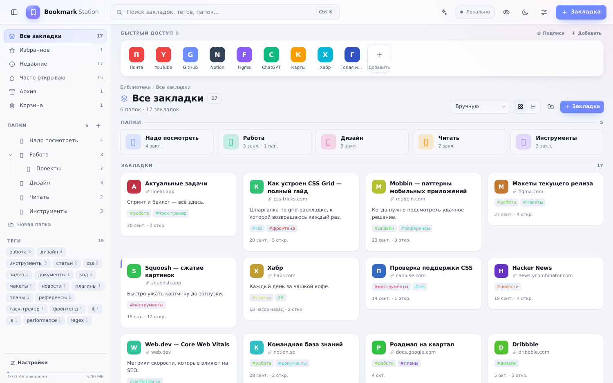
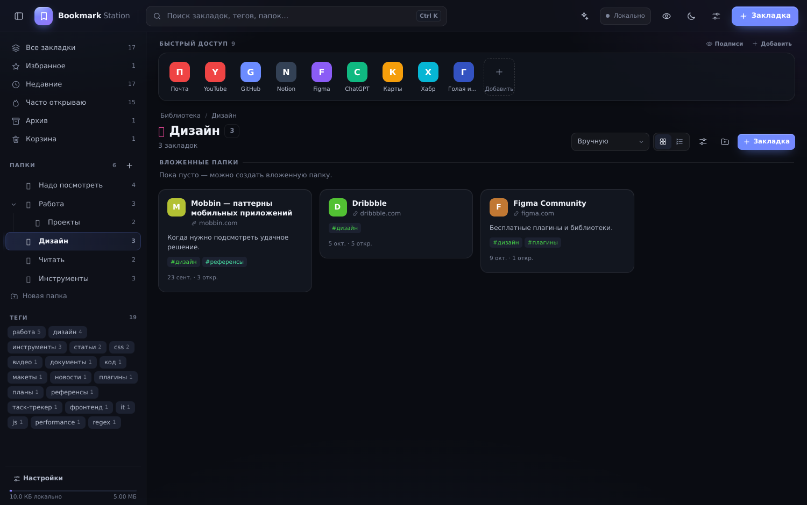

# Bookmark Station

Один HTML-файл — полноценный менеджер закладок вместо новой страницы браузера.
Без сервера, без сборки, без аккаунтов: открываете `bookmark-station.html` двойным
щелчком и держите вкладку на виду.





## Как это использовать

1. Скачайте **`bookmark-station.html`** (`index.html` — та же копия для веба) (224 КБ, всё внутри: стили, скрипт, иконка).
2. Положите в удобную папку и закрепите вкладку в браузере (`Ctrl+D` → на панель).
3. Подключите JSON-файл (шестерёнка → «Подключить файл») — и все изменения будут
   автоматически записываться на диск. Ничего не потеряется при чистке браузера.
4. Хотите видеть закладки как новую страницу — в настройках браузера укажите файл
   как домашнюю страницу.

Работает офлайн: интернет нужен только для загрузки фавиконов сайтов
(можно выключить и оставить цветные буквы).

## Что умеет

**Структура**
- Неограниченная вложенность папок с эмодзи и цветом.
- Теги с автоматической облаком-навигацией и цветами.
- Избранное, Архив (скрыто, но под рукой), Корзина с восстановлением.
- Умные разделы: Недавние, Часто открываю (счётчик переходов).
- Поиск по всей библиотеке: название, адрес, описание, заметки, теги, имена папок.

**Быстрый доступ**
- Отдельная панель иконок самых частых сайтов над контентом.
- Своя иконка для каждой кнопки: фавикон, буква на выбранном цвете, эмодзи или
  ссылка на картинку.
- У каждой кнопки можно **убрать название** — останется только иконка. Есть общий
  переключатель «Подписи / Только иконки» в заголовке панели и в настройках.
- Кнопки правятся в режиме редактирования: клик по иконке открывает настройки,
  перетаскивание меняет порядок. Правый клик (или долгое нажатие на телефоне) —
  меню с пунктами «Изменить», «Только иконка», «Убрать с панели».
- Любую закладку можно перетащить на панель — она станет кнопкой.

**Два режима: просмотр и редактирование**
- **Просмотр** — чистый интерфейс: на карточках нет звёздочек, меню и кнопок,
  перетаскивание выключено, клик сразу открывает сайт.
- **Редактирование** (кнопка-глаз в шапке или `Ctrl/⌘ + E`) — появляются кнопки
  «изменить» и «ещё», звёздочки, меню папок, перетаскивание. Клик выделяет
  закладку, двойной клик открывает сайт.
- Режим запоминается, его же можно переключить в настройках.

**Перетаскивание и массовые операции**
- Перетаскивайте закладки между папками и внутри папки (с индикатором места).
- Перетаскивайте папки, чтобы вкладывать их друг в друга.
- Бросайте закладку на «Архив», «Избранное», «Корзина» в боковой панели.
- Меняйте порядок кнопок быстрого доступа.
- Режим «Выбрать» → мультивыделение → открыть пачкой, в избранное, в папку,
  в архив, удалить.
- Ctrl/⌘+клик и Shift+клик работают и без режима выделения.
- Контекстное меню по правой кнопке на закладке, папке и быстрой ссылке.

**Данные**
- Хранение в `localStorage` (автосохранение каждого действия).
- **Живой JSON-файл на диске** через File System Access API: приложение пишет в него
  каждое изменение; файл можно держать в Dropbox/iCloud/Git.
- Экспорт/импорт JSON (полная копия) и HTML (формат Netscape — понимают все браузеры).
- Импорт HTML из Chrome/Firefox/Safari/Edge: структура папок и теги сохраняются.
- Восемь локальных точек восстановления + «отменить» в уведомлениях.
- Перетащите `.json` или `.html` прямо в окно — импорт запустится сам.

**Интерфейс**
- Тёмная/светлая/системная тема, 8 акцентных цветов, настройка ширины карточек,
  плотности, боковой панели (тянется мышью).
- Сетка или список, сортировки: вручную, новые, старые, по названию, по сайту,
  по частоте.
- Палитра команд `Ctrl+K`, горячие клавиши на всё, полноэкранная вёрстка без меню.
- Адаптив для узких окон и планшетов.

## Горячие клавиши

| Клавиши | Действие |
| --- | --- |
| `Ctrl/⌘ K` | Палитра команд и поиск |
| `Ctrl/⌘ N` | Новая закладка |
| `Ctrl/⌘ Shift N` | Новая папка |
| `Ctrl/⌘ B` | Показать/скрыть панель |
| `Ctrl/⌘ E` | Просмотр ↔ редактирование |
| `Ctrl/⌘ S` | Сохранить в JSON-файл |
| `Ctrl/⌘ ,` | Настройки |
| `/` | Фокус в поиск |
| `E` | Изменить выделенную |
| `Ctrl/⌘ A` | Выделить всё (в режиме правки) |
| `Del` | В корзину |
| `Esc` | Закрыть / снять выделение |

## Формат JSON

```json
{
  "version": 1,
  "settings": { "theme": "auto", "accent": "#6c8cff", "view": "grid" },
  "dock":    [{ "id": "dock_1", "title": "Почта", "url": "https://mail.google.com/", "iconType": "favicon", "color": "#ef4444", "order": 0 }],
  "folders": [{ "id": "f_1", "name": "Надо посмотреть", "emoji": "👀", "parentId": null, "order": 0 }],
  "bookmarks": [{
    "id": "b_1", "title": "Статья", "url": "https://example.com/",
    "description": "", "notes": "", "tags": ["читать"], "folderId": "f_1",
    "favorite": false, "archived": false,
    "iconType": "favicon", "icon": "", "color": "",
    "clicks": 3, "createdAt": 1729600000000, "lastOpened": 1729600000000, "order": 0
  }],
  "trash": []
}
```

JSON можно править руками или генерировать скриптом — приложение прочитает его при
подключении (или через «Импорт JSON»). Неизвестные поля игнорируются, отсутствующие
подставляются по умолчанию.

## Разработка

```bash
npm run build   # src/{template.html,styles.css,app.js} → bookmark-station.html + index.html
npm run dev     # сборка + локальный сервер на http://localhost:4173
npm run check   # синтаксическая проверка app.js
```

Исходники специально разделены, а результат — один самодостаточный файл.
Сервер нужен только для удобного предпросмотра: для синхронизации с JSON файл
надо открывать с диска (`file://`), потому что браузеры не дают доступ к файловой
системе страницам из iframe и некоторых встроенных просмотрщиков.

## Совместимость

Chrome, Edge, Opera, Yandex Browser, Firefox, Safari — последние версии.
Прямая запись в JSON-файл: браузеры на Chromium (Chrome, Edge, Opera, Яндекс) и
некоторые другие с File System Access API. Остальным доступны экспорт/импорт JSON,
скачивание копии (`Ctrl+S`) и автобэкапы в браузере.
